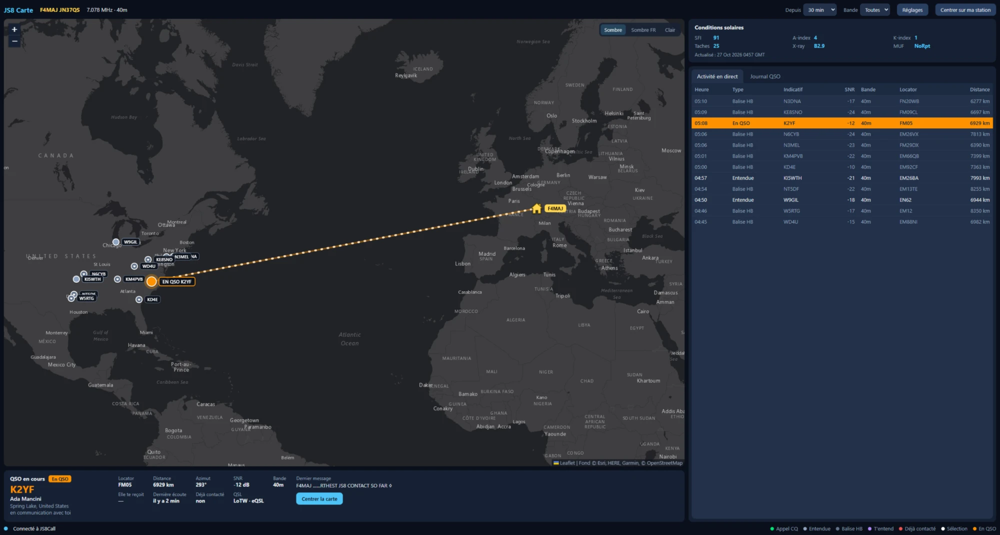
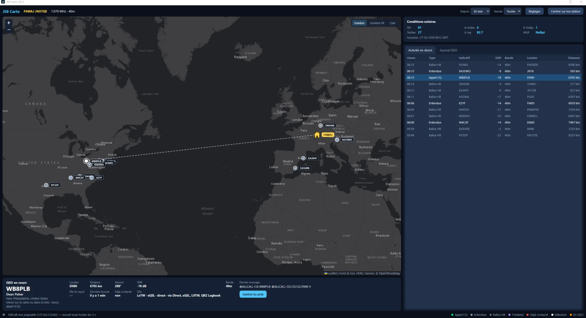
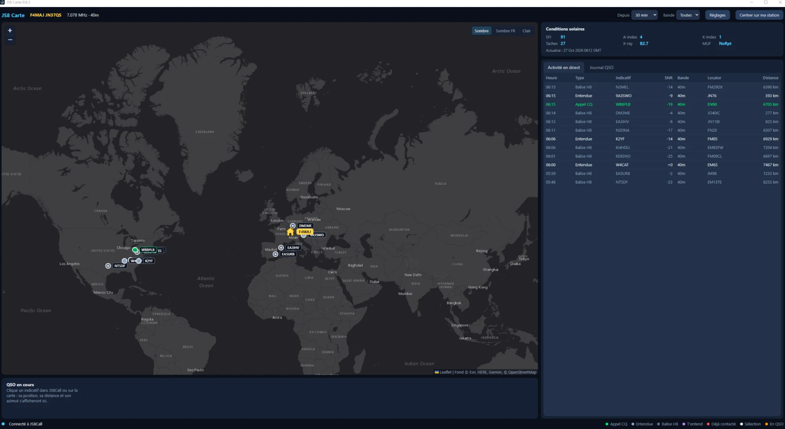

# JS8 Carte

[](https://github.com/LesF4/js8-carte/releases/latest)
[](https://github.com/LesF4/js8-carte/releases)
[](LICENSE)



Petite carte légère des stations **JS8Call** (Windows, Python 3 ; interface HTML + Leaflet dans une fenêtre
Edge WebView2 via pywebview) :

- carte fluide (zoom progressif) avec fond sombre Esri, sombre OpenStreetMap France ou clair ;
- fiche QRZ.com avec photo pour la station choisie (abonnement XML, mot de passe chiffré par Windows) ;
- **QSO en cours** : l'indicatif sélectionné dans JS8Call, son locator, la distance, l'azimut, le SNR,
  le dernier message, et un trait depuis ta station ;
- **Activité en direct** (heure, type, indicatif, SNR, bande, locator, distance) et **Journal QSO** ;
- conditions solaires (hamqsl.com) ;
- filtres : durée (15 min à 4 h) et bande.

## En images

**Une station lance appel (CQ)** : choisie dans JS8Call, elle passe au premier plan avec sa fiche QRZ.com
(nom, ville, QSL) et la distance depuis ta station.



**Vue d'ensemble** : toutes les stations entendues depuis l'ouverture, ta station représentée par la maison.



## Remerciements

JS8 Carte est inspirée du **MultiDigi Tracker** de **Nicolas F4LPS** (logiciel MultiDigi) : l'idée d'une carte
légère des stations, l'agencement de l'écran (carte, « QSO en cours », conditions solaires, activité en direct
et journal) et le trait animé du QSO viennent de son travail. Le code de JS8 Carte a été écrit séparément,
pour JS8Call uniquement. Merci Nicolas !

## Installation

Télécharger `JS8Carte-Setup-….exe` dans les Releases et l'exécuter (pas besoin d'être administrateur).
Au premier lancement, Windows SmartScreen : « Informations complémentaires » puis « Exécuter quand même »
(application non signée). Nécessite Microsoft Edge WebView2, déjà présent sur Windows 11.

## Branchement sur JS8Call

JS8 Carte utilise l'API TCP de JS8Call (127.0.0.1:2242). Si un autre programme y est déjà connecté
(par exemple JS8toHRD), passer dans JS8Call le nombre maximal de connexions TCP de l'API à **2**.
JS8 Carte n'envoie à JS8Call que des questions (station sélectionnée, stations entendues, fréquence) :
elle ne commande jamais l'émission.

## Lancer depuis les sources

```bash
pip install pywebview pillow
python JS8Carte.pyw
python -m unittest tests.test_core
```

Tester sans radio : `python tests/simulate.py 2252` (faux JS8Call), avec `"js8_port": 2252` dans
`config.json` d'un dossier de test désigné par la variable `JS8CARTE_DATA`.

Réglages et journal : `%APPDATA%\JS8Carte\`.

Construire l'exe et l'installeur : `pip install pyinstaller pywebview pillow`, Inno Setup 6, puis
`python packaging/build.py --installer`.

Licence MIT — F4MAJ. Idée et agencement : MultiDigi Tracker de Nicolas F4LPS. Leaflet © Volodymyr Agafonkin (BSD-2). Fonds de carte © Esri, © OpenStreetMap France /
contributeurs OpenStreetMap.
